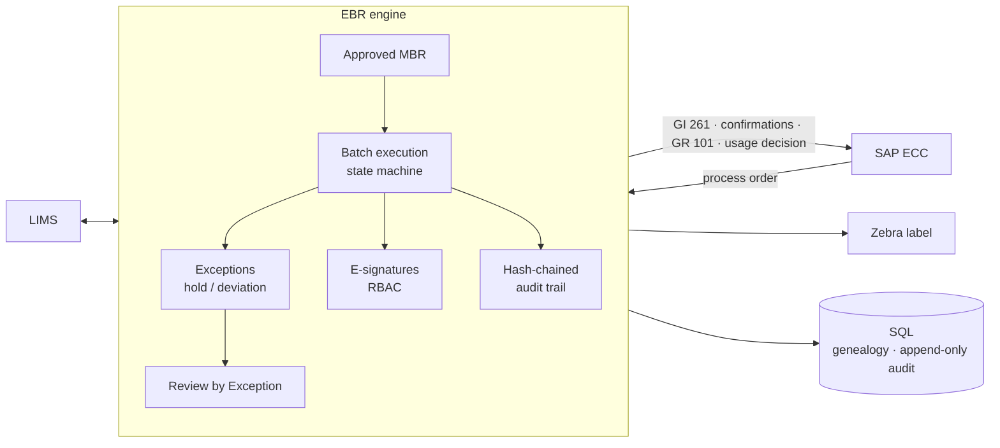

# Pharmaceutical EBR / eMBR & PAS-X Implementation

A working **Electronic Batch Record (EBR) execution engine** with a complete **GMP computer-system-validation package**. It is modelled on the Werum PAS-X MES implementation work I supported as an MES Consultant at **KBI Biopharma** (Feb 2024 – present).

> ⚠️ **Portfolio reconstruction, no proprietary content.** This repository contains **no** KBI Biopharma data, documents, recipes or PAS-X configuration, and no PAS-X software. The product, users, batches and deviations are fictitious. The code re-implements the *concepts* (master recipes, EBR execution, exceptions, e-signatures, Part 11 audit trail, review by exception, SAP integration) in Python to show the domain knowledge and validation approach. PAS-X is a trademark of Körber Pharma.

   

---

## What it demonstrates

| Area | Implemented |
|---|---|
| **Master Batch Record** | JSON master recipe for a film-coated tablet: dispensing → wet granulation → blending → compression → coating → packaging, with BOM, CPP/CQA limits and signature rules. Only *Approved* MBRs can run |
| **EBR execution** | Batch state machine (Created → In Execution ⇄ On Hold → Executed → Under Review → Released/Rejected), enforced step sequence |
| **Weigh & dispense** | Barcode identity check, container status/expiry check, BOM tolerance, automatic SAP goods issue |
| **Equipment checks** | Clean status and calibration validity before use |
| **Exceptions & deviations** | Automatic out-of-limit exceptions; **CQA excursion → automatic batch HOLD**; mandatory deviation link for Major; QA closure |
| **Electronic signatures** | Re-authentication, performer/verifier four-eyes rule, signature manifest, lockout after 3 failures |
| **Audit trail** | SHA-256 hash-chained, tamper-evident; append-only enforced by **database triggers** |
| **Review by Exception** | QA report covering exceptions, holds, reconciliation and audit-trail integrity only |
| **SAP ECC integration** | Process order in; GI 261, operation confirmations, GR 101, QM usage decision out |
| **LIMS / Zebra** | Sample request and result retrieval; ZPL II shipper label with GS1-128 barcode |
| **Traceability (SQL)** | Backward/forward genealogy, exception report, CPP/CQA summary, e-signature report |
| **Validation (CSV)** | URS, FS, DS, RTM, GAMP 5 risk assessment, IQ/OQ/PQ, Part 11 matrix, change control, VSR, SOP |

## Demo run

```bash
git clone https://github.com/saivamsi462000/pharma-ebr-pasx-mes.git
cd pharma-ebr-pasx-mes
python -m venv .venv && source .venv/bin/activate
pip install -r requirements.txt

python run_demo.py      # executes batch B260302 end to end
pytest -v               # 22 automated OQ test cases, named by URS ID
```

```
After hardness IPC: batch status = ON_HOLD
Final status      : RELEASED
Exceptions        : 2 (all closed: True)
Yield             : 97.61%
SAP messages sent : 13 -> CONFIRMATION, GOODS_ISSUE, GOODS_RECEIPT, USAGE_DECISION
Audit entries     : 70 (chain verified: True)
Genealogy rows    : 5
```

Generated evidence in [`output/`](output/):
[Review by Exception](output/review_by_exception.md) · [Full EBR](output/electronic_batch_record.md) · [SAP outbox](output/sap_outbox.json) · [Audit trail](output/audit_trail.csv) · [Zebra label (ZPL)](output/shipper_label.zpl)

## Architecture



Full ISA-95 landscape (SAP ECC ↔ PAS-X ↔ Ignition ↔ PLC ↔ LIMS) and a sequence diagram: [docs/design/Architecture.md](docs/design/Architecture.md)

## Validation document set

| Document | Purpose |
|---|---|
| [URS](docs/validation/URS.md) | 20 user requirements (GMP, Part 11, integration) |
| [Functional Specification](docs/validation/Functional_Specification.md) | Batch lifecycle and 19 functions |
| [Design Specification](docs/validation/Design_Specification.md) | Modules, data model, security, SAP message design |
| [Risk Assessment (GAMP 5 / FMEA)](docs/validation/Risk_Assessment_GAMP5.md) | 10 risks, RPN scoring, controls |
| [RTM](docs/validation/RTM.md) | URS → FS → DS → test, 100% coverage |
| [IQ / OQ / PQ Protocols](docs/validation/IQ_OQ_PQ_Protocols.md) | Installation, operational and performance qualification |
| [Part 11 / Annex 11 Matrix](docs/validation/Part11_Compliance_Matrix.md) | Clause-by-clause compliance plus ALCOA+ |
| [Change Control](docs/validation/Change_Control_Template.md) | Worked CR for an IPC limit change, DEV → QA → PROD |
| [Validation Summary Report](docs/validation/Validation_Summary_Report.md) | Results and conclusion |
| [SOP: EBR Execution & RBE](docs/sop/SOP_EBR_Execution_and_Review.md) | Operator / supervisor / QA procedure |

## Repository layout

```
├── ebr/
│   ├── recipe.py         # MBR model + validation
│   ├── engine.py         # batch state machine, phase handlers, exceptions, QA workflow
│   ├── security.py       # RBAC, e-signatures, PBKDF2 PINs, lockout
│   ├── audit.py          # SHA-256 hash-chained audit trail
│   ├── integration.py    # SAP ECC gateway, LIMS stub, equipment/containers, ZPL labels
│   ├── persistence.py    # SQL persistence + traceability queries
│   └── review.py         # Review by Exception + full EBR report
├── recipes/MBR-TAB-500.json
├── sql/schema.sql · sql/traceability_queries.sql
├── tests/test_ebr.py     # OQ test cases named by URS ID
├── run_demo.py
├── output/               # generated batch evidence
└── docs/{design,validation,sop}/
```

## Skills and tools

Werum PAS-X concepts (MBR/EBR, review by exception) · GMP · FDA 21 CFR Part 11 · EU Annex 11 · GAMP 5 · CSV (URS/FS/DS/RTM/IQ/OQ/PQ) · ALCOA+ · SAP ECC (PP-PI, MM, QM) integration · LIMS · ISA-95 · SQL · Python · pytest

## Author

**Gopi Satya Sai Vamsi** · MES Consultant · [LinkedIn](https://www.linkedin.com/in/sai-vamsi-2740621ab/) · [GitHub](https://github.com/saivamsi462000)
