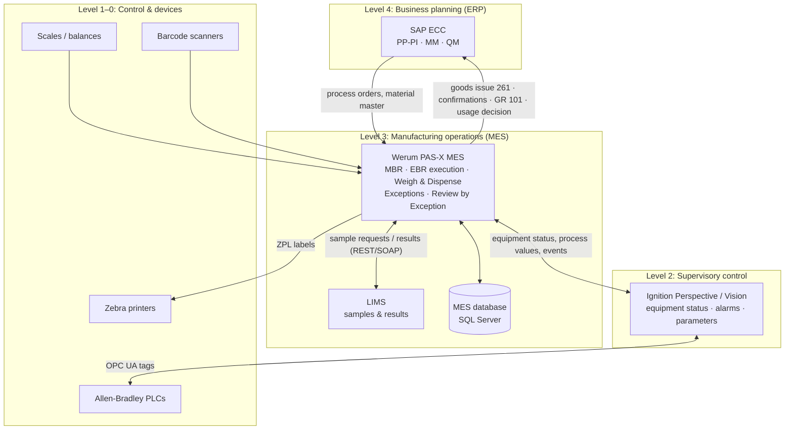
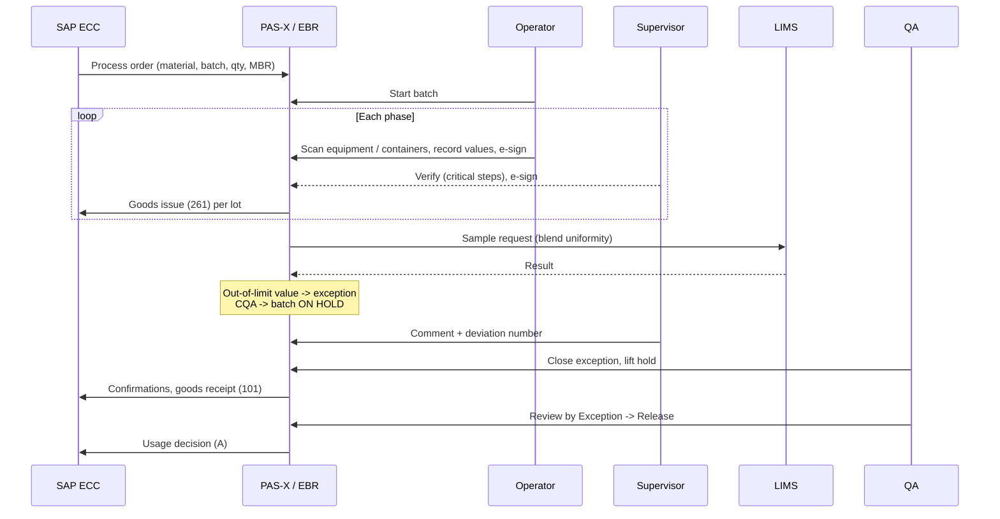

# System Architecture: Pharmaceutical MES / EBR Landscape

## ISA-95 view

## Batch data flow

## How this repository maps to PAS-X concepts

| PAS-X concept (general) | This repository |
|---|---|
| Master Batch Record (MBR) / master recipe | `recipes/MBR-TAB-500.json` |
| Process flow / operations & phases | `operations[].phases[]` |
| Building blocks for weighing, IPC, sampling, labelling | `_do_<type>` phase handlers |
| Exception handling & review by exception | `BatchException`, `review_by_exception()` |
| User roles, e-signatures | `ebr/security.py` |
| Audit trail | `ebr/audit.py` + `audit_trail` table |
| ERP interface | `SapEccGateway` |

> PAS-X is a commercial product of Körber Pharma. This repository does **not** contain PAS-X software, configuration exports or customer data. It re-implements the *concepts* in Python to demonstrate the domain knowledge and validation approach.
