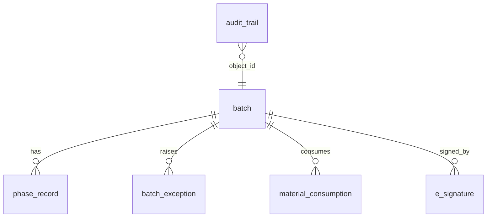

# Design Specification (DS)

| Document ID | DS-EBR-001 · responds to FS-EBR-001 |
|---|---|

## 1. Software modules

| Module | File | Implements |
|---|---|---|
| Recipe | `ebr/recipe.py` | `MasterRecipe`, `Phase`; JSON load; structural validation (FS-01, FS-02) |
| Engine | `ebr/engine.py` | `Batch` state machine; phase handlers; exceptions; QA workflow; reconciliation (FS-03 … FS-09, FS-19) |
| Security | `ebr/security.py` | `UserDirectory`, `PERMISSIONS`, `ESignature`; PBKDF2 PIN hashing; lockout (FS-11 … FS-13) |
| Audit | `ebr/audit.py` | `AuditTrail` hash chain (FS-14) |
| Integration | `ebr/integration.py` | `SapEccGateway`, `LimsStub`, `Equipment`, `Container`, `zebra_label` (FS-10, FS-18) |
| Persistence | `ebr/persistence.py`, `sql/schema.sql` | SQL tables, immutability triggers, traceability queries (FS-15, FS-16) |
| Reporting | `ebr/review.py` | Review-by-Exception and full EBR printouts (FS-17) |

## 2. Master recipe structure (`recipes/MBR-TAB-500.json`)

```
MBR
├── product (material, batch size, theoretical yield)
├── bom[] (material, qty_kg, tolerance_pct)
└── operations[] (op_id, name, equipment_class)
    └── phases[] (phase_id, type, instruction, signature, [parameter, target, low, high, criticality], ...)
```

Phase types: `line_clearance`, `equipment_check`, `weigh_dispense`, `process_parameter`, `sampling`, `lims_result`, `label_print`, `yield`. Each type maps to an engine handler `_do_<type>`, so adding a building block means adding one handler.

## 3. Data model



## 4. Security design

- PINs are never stored. Only `PBKDF2-HMAC-SHA256(pin, 16-byte salt, 100k iterations)` is kept.
- Comparison uses `hmac.compare_digest`, a constant-time compare.
- Signatures are created *before* a phase's data is committed, so a failed signature leaves no partial record.
- `ESignature` is a frozen dataclass bound to `record_id` (§11.70 signature/record linking).

## 5. Interface message design (SAP ECC)

| Message | Direction | Trigger | Key fields |
|---|---|---|---|
| Process order | SAP → MES | Order release | order_no, material, batch, planned_qty, mbr_id |
| GOODS_ISSUE (261) | MES → SAP | Each dispensed lot | order_no, material, lot, qty, uom |
| CONFIRMATION | MES → SAP | Last phase of each operation | order_no, operation |
| GOODS_RECEIPT (101) | MES → SAP | Yield phase | material, batch, qty, stock_type = QI |
| USAGE_DECISION | MES → SAP | QA disposition | batch, decision A/R |

In production these are carried over IDoc/RFC or a middleware layer with retry and dead-letter handling. Here they are queued in `SapEccGateway.outbox`.

## 6. Configuration management

All configuration (MBR JSON, roles, SQL) is version-controlled in Git. Changes follow the change-control template (`docs/validation/Change_Control_Template.md`) and are promoted DEV → QA → PROD.
