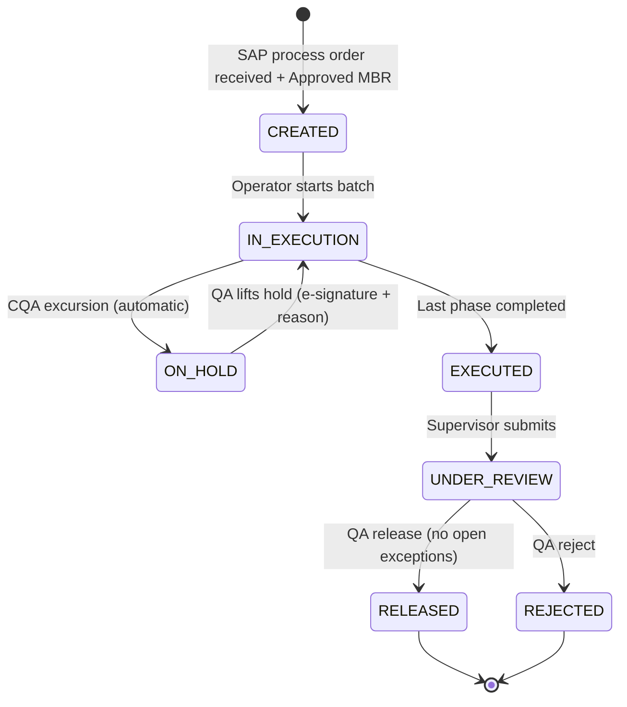

# Functional Specification (FS)

| Document ID | FS-EBR-001 · responds to URS-EBR-001 |
|---|---|

## 1. Batch lifecycle

## 2. Functions

| FS ID | Function | Behaviour | URS |
|---|---|---|---|
| FS-01 | MBR load & approval check | The MBR is loaded from the recipe definition. Batch creation fails unless the MBR status is `Approved`. | URS-01 |
| FS-02 | MBR structural validation | Rejects duplicate phase IDs, unknown phase types, invalid signature rules, low > high limits, and materials not in the BOM. | URS-02 |
| FS-03 | Sequential execution | `next_phase()` returns the first pending phase. Executing any other phase raises *Out of sequence*. | URS-03 |
| FS-04 | Equipment check | Each scanned equipment ID must exist, be `Clean`, and have `calibration_due ≥ today`. | URS-04 |
| FS-05 | Weigh & dispense | For each BOM material, the scanned container must match the material, be `Released` and unexpired; the net weight must be within ±tolerance%. | URS-05, URS-06 |
| FS-06 | Limit check & exception | Recorded value outside [low, high] → exception `EXC-<batch>-nn`, severity Major for CPP/CQA and Minor for KPI. | URS-07 |
| FS-07 | Automatic hold | A CQA exception sets status `ON_HOLD`. `execute_phase` is rejected in any status other than `IN_EXECUTION`. | URS-08 |
| FS-08 | Exception workflow | Open → Commented (supervisor e-sign + comment + deviation no.) → Closed (QA e-sign). Major exceptions without a deviation no. cannot close. | URS-09 |
| FS-09 | QA disposition | Release is blocked if any exception is not Closed. Sends a usage decision (A/R) to SAP. | URS-10, URS-11 |
| FS-10 | SAP interface | Inbound process order is validated for mandatory fields. Outbound: GI 261 per dispensed lot, confirmation per completed operation, GR 101 at yield, usage decision at disposition. | URS-11 |
| FS-11 | Dual signature | `performer_verifier` phases need two signatures from different user IDs, and the verifier must hold `sign_verifier`. | URS-12 |
| FS-12 | Re-authentication | PIN checked with PBKDF2-SHA256 (salted) at every signature. 3 consecutive failures → account inactive + audit entry. | URS-13 |
| FS-13 | RBAC | Roles: Operator, Supervisor, QA Reviewer, MES Admin. Permissions are attached to roles only. Admin has no execution or release permissions. | URS-14 |
| FS-14 | Audit trail | Append-only list. Each entry holds seq, UTC timestamp, user, action, object, old/new value, reason, prev_hash and SHA-256 hash. `verify()` recomputes the chain. | URS-15 |
| FS-15 | DB immutability | `BEFORE UPDATE` / `BEFORE DELETE` triggers on `audit_trail` abort with *append-only*. | URS-16 |
| FS-16 | Genealogy | Consumption records (material, lot, container, qty) stored per batch; SQL queries provide backward and forward genealogy. | URS-17 |
| FS-17 | Review by Exception | The report shows exceptions, signatures, holds, reconciliation and audit-trail integrity, and only *counts* in-limit values. | URS-18 |
| FS-18 | Label printing | Generates a ZPL II label with GS1-128 barcode (01) GTIN (10) batch (17) expiry. | URS-19 |
| FS-19 | Reconciliation | Issued vs BOM quantity and variance % per material. | URS-20 |
